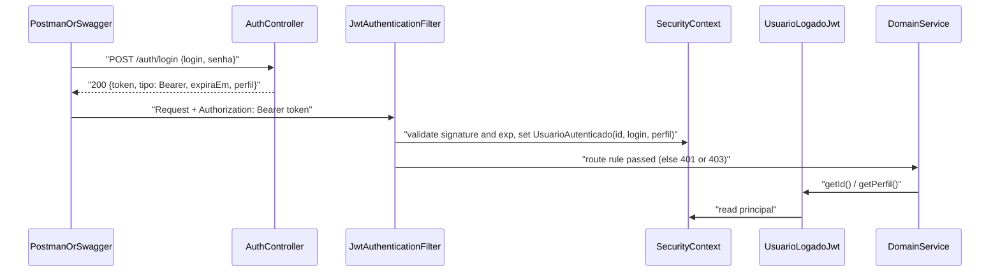

# Sistema de Simulação de Eleição Eletrônica (Back-End)

API REST em Java com Spring Boot e MySQL.

## Tecnologias
Java 17, Spring Boot, Spring Data JPA, Spring Security + JWT, Bean Validation, MySQL, springdoc (Swagger UI), JUnit 5 e H2 (testes).

## Como rodar
1. Ter o JDK 17 (ou superior) e o MySQL ligados.
2. Definir as variáveis de ambiente:
   - `DB_USER` (padrão: `root`)
   - `DB_PASSWORD` (padrão: `admin`)
   - `JWT_SECRET` (obrigatória, use uma chave aleatória com pelo menos 32 bytes, inclusive no perfil `dev` para que o login continue disponível)
3. Na pasta `sistema/`, subir a aplicação:
   - **Com segurança JWT ativa (padrão):** `./mvnw spring-boot:run`
   - **Modo de desenvolvimento sem validação de token** (simulação via cabeçalhos `X-Usuario-Id` e `X-Perfil`): `./mvnw spring-boot:run -Dspring-boot.run.profiles=dev`
4. Na primeira inicialização, caso não exista nenhum usuário `CHEFE`, o sistema cria automaticamente o Chefe da Seção inicial:
   - **Login:** `chefe` (configurável por `chefe.login`)
   - **Senha:** defina `CHEFE_SENHA` antes de iniciar com um banco sem Chefe. Em bancos que já têm um Chefe, essa variável não altera a senha cadastrada.
5. Swagger UI: http://localhost:8080/swagger-ui.html (especificação JSON em http://localhost:8080/v3/api-docs)

## Testes
`./mvnw test`

## Arquitetura

A aplicação segue uma **arquitetura em camadas** dentro de uma organização **package-by-feature** (`br.com.eleicao.sistema.<dominio>`), mantendo um pacote `shared/` para tipos e configurações transversais (`enums`, OpenAPI/Swagger).

### Camadas
- **Controller (`controller/`)**: exposição dos endpoints REST, validação de entrada (`@Valid`) e contratos HTTP/OpenAPI.
- **Service (`service/`)**: implementação das regras de negócio, controle transacional e orquestração entre repositórios.
- **Repository (`repository/`)**: interfaces Spring Data JPA para persistência relacional.
- **Model e DTO (`model/`, `dto/`)**: entidades JPA isoladas dos objetos de transferência (`record`), evitando expor dados sensíveis (como hashes de senha) na API.

### Inversão de dependência do usuário autenticado (`UsuarioLogado`)
Os serviços de negócio não dependem diretamente de cabeçalhos HTTP nem da biblioteca JWT: eles consultam a interface `UsuarioLogado` (`getId()` e `getPerfil()`). A implementação ativa é selecionada por perfil do Spring:
- **Perfil padrão (`!dev`)**: `SecurityConfig` ativa a cadeia stateless com `JwtAuthenticationFilter`, e `UsuarioLogadoJwt` lê o `UsuarioAutenticado` do `SecurityContext`.
- **Perfil `dev`**: `DevSecurityConfig` libera as rotas para desenvolvimento isolado, e `UsuarioLogadoDev` lê os cabeçalhos `X-Usuario-Id` e `X-Perfil`.
- **Perfil `test`**: substitui o MySQL por banco H2 em memória (`create-drop`) para execução rápida e isolada dos testes de integração.

## Segurança e Autenticação

A API é **stateless** (`SessionCreationPolicy.STATELESS`, CSRF desabilitado) e utiliza **JSON Web Token (JWT)** assinado com `HMAC-SHA256` (`HS256`).

### Fluxo e credenciais
- **Senhas**: armazenadas exclusivamente com hash `BCrypt` (`BCryptPasswordEncoder`, com *salt* aleatório por registro).
- **Chefe inicial**: na subida da aplicação, caso não exista nenhum usuário com perfil `CHEFE`, `ChefeInicialConfig` cria o usuário com o login `chefe` (configurável por `CHEFE_LOGIN`) e a senha informada em `CHEFE_SENHA`.
- **Emissão do token (`POST /auth/login`)**: valida credenciais e devolve `{ token, tipo: "Bearer", expiraEm, perfil }`. Claims incluídas no JWT: `sub` (login), `id` (id da tabela `usuario`), `perfil` (`CHEFE`, `ELEITOR` ou `CANDIDATO`), `iat` e `exp`.
- **Identidade atual (`GET /auth/me`)**: retorna `{ id, login, perfil }` do usuário autenticado a partir do token.
- **Respostas de erro padronizadas**:
  - `401 Unauthorized`: requisição sem token ou com token inválido/adulterado/expirado (ou falha de credenciais no login).
  - `403 Forbidden`: usuário autenticado, porém com perfil sem permissão para a rota ou método HTTP solicitado.
- **Sigilo do voto**: o token JWT identifica o eleitor apenas para verificar aptidão e registrar o `ComprovanteVotacao`; a entidade `Voto` não armazena referência ao eleitor nem ao usuário.

### Regras de acesso por rota (`SecurityConfig`)

| Método(s) | Rota | Acesso permitido |
| --- | --- | --- |
| `POST` | `/auth/login` | Público |
| `GET` | `/swagger-ui.html`, `/swagger-ui/**`, `/v3/api-docs/**` | Público |
| `GET` | `/auth/me` | Qualquer usuário autenticado |
| `GET` | `/eleicoes`, `/eleicoes/**` | Qualquer usuário autenticado (`CHEFE`, `ELEITOR`, `CANDIDATO`) |
| `POST`, `PUT`, `PATCH`, `DELETE` | `/eleicoes`, `/eleicoes/**` | `CHEFE` |
| Todos | `/eleitores`, `/eleitores/**` | `CHEFE` |
| `GET` | `/candidatos?eleicaoId={id}&cargo={cargo}` (ambos os filtros) | `CHEFE`, `ELEITOR` |
| Demais operações | `/candidatos`, `/candidatos/**`, `/partidos`, `/partidos/**` | `CHEFE` |
| Todos | `/urna`, `/urna/**` | `ELEITOR` |
| Todos | `/acompanhamento/**`, `/resultados/**`, `/apuracao/**` | `CHEFE`, `ELEITOR`, `CANDIDATO` (filtro por cargo do candidato no serviço) |

### Uso no Swagger UI e no Postman
- **Swagger UI** (`http://localhost:8080/swagger-ui.html`): execute `POST /auth/login`, copie o `token`, clique em **Authorize**, cole o token e confirme (`persist-authorization` mantém o token ao recarregar a página).
- **Postman**: importe `postman/sistema-eleicao.postman_collection.json` e o ambiente `postman/local.postman_environment.json`. As requisições da pasta **Autenticação** salvam automaticamente `{{token}}` no ambiente, e a coleção inteira já herda `Authorization: Bearer {{token}}`.

### Módulos `eleitor` e `candidato`

Cadastros que alimentam a eleição: eleitores, candidatos e partidos. O acesso é restrito ao **Chefe da Seção**. O **Eleitor** pode consultar candidatos informando a eleição e o cargo.

#### Eleitores

| Método | Rota | Função |
| --- | --- | --- |
| POST | `/eleitores` | Cadastra o eleitor e o seu usuário de acesso |
| GET | `/eleitores` | Lista os eleitores |
| GET | `/eleitores/{id}` | Consulta um eleitor |
| PUT | `/eleitores/{id}` | Altera nome e documento |
| DELETE | `/eleitores/{id}` | Exclui o eleitor e o seu usuário |

#### Candidatos

| Método | Rota | Função |
| --- | --- | --- |
| POST | `/candidatos` | Cadastra o candidato com cargo, partido, eleição e usuário de acesso |
| GET | `/candidatos` | Lista os candidatos |
| GET | `/candidatos?eleicaoId=&cargo=` | Lista os candidatos disponíveis para votação em um cargo |
| GET | `/candidatos/{id}` | Consulta um candidato |
| PUT | `/candidatos/{id}` | Altera nome e partido |
| DELETE | `/candidatos/{id}` | Exclui o candidato e o seu usuário |

#### Partidos

CRUD em `/partidos` (`POST`, `GET`, `PUT`, `DELETE`), necessário para associar os candidatos.

#### Regras

- Documento do eleitor, sigla do partido e login são únicos (`409` se repetir).
- O número do candidato é único por cargo e eleição (`409` se repetir).
- Partido ou eleição inexistente no cadastro do candidato retorna `404`.
- Campos obrigatórios vazios retornam `400`.
- Cada cadastro cria também o `Usuario` de acesso (`ELEITOR` ou `CANDIDATO`), com senha em BCrypt. As respostas nunca devolvem a senha.
- Excluir um eleitor ou candidato remove também o seu usuário.

Exemplos de requisição e resposta estão no Swagger UI.
